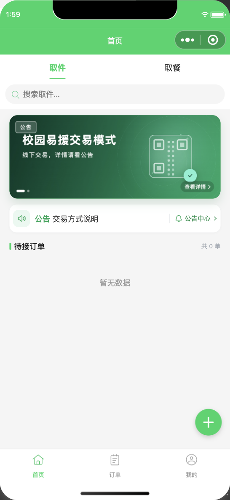
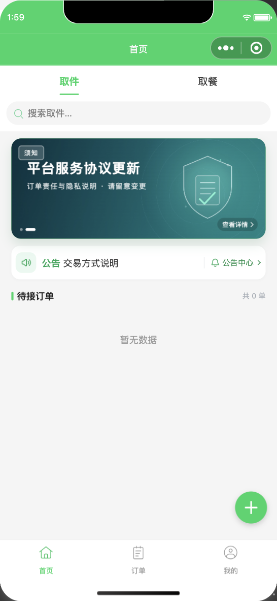
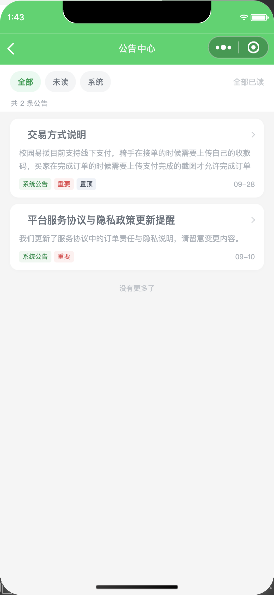
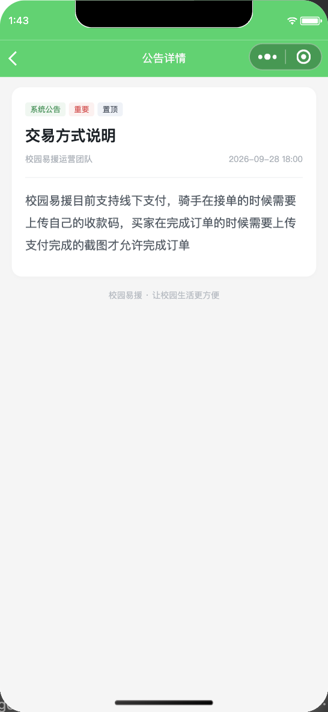

# 校园易援（CampusHelp）

> 校园互助跑腿小程序 —— 取件代取 / 取餐代取，含完整的微信小程序前端与 Spring Boot 后端。


仓库地址：<https://github.com/HYF-2005/xiaoyuanyiyuan>

---

## 版本说明

| 标签 | 提交 | 内容 |
|---|---|---|
| `v1.0.0` | `a668a1c` | 首版：登录注册、订单发布与接单、账户、信用分、账单等 |
| `v1.1.0` | `0324eb4` | 新增公告中心、公告详情、首页公告条、未读红点、登录后 5 秒强提醒、首页轮播 |
| `v1.2.0` | `b647c56` | 新增管理后台、权限管理、学生批量导入、风险订单、财务与内容管理；重构实名认证注册流程 |
| `v1.3.0` | `3ff94f7` | 订单详情支持对当前订单发起问题反馈，后台可看到关联订单 |
| `v1.3.1` | 见最新提交 | 反馈的订单关联改为结构化字段 `feedback.order_id`，不再把订单号拼进正文 |

当前 `main` 对应 `v1.3.1`。

> 关于「两版轮播」：
>
> - `v1.0.0`、`v1.1.0`、`v1.2.0`、`v1.3.0` 是**历史版本**；
> - 当前代码使用**动态文字版**轮播：背景图不带字，标题/副标题由 WXML 从数据库读取并渲染；
> - `design/banners/*-with-text.jpg` 是之前的整图版素材，只做设计归档；
> - 当前代码如果直接换回带字图片，会出现文字重影。整图版和动态版要同时可切换，需要额外增加 `render_mode` 字段，目前尚未实现。

---

## 一、项目简介

面向高校场景的互助跑腿平台。学生在平台发布取件或取餐需求，其他同学接单并完成配送，平台负责订单状态流转、身份校验、信用分与账单结算。

**本项目为完整的前后端分离实现**，非静态演示。包含：

- 微信小程序前端（21 个页面）
- Spring Boot 后端服务（RESTful API + 单元测试）
- MySQL 数据库设计（15 张表，含外键与索引）
- 首页公告条、公告中心、公告详情、未读红点、登录后强制阅读 5 秒
- 首页轮播：背景图 + 数据库动态文案，点击跳转公告或站内页面
- 部署配置（nginx / systemd / macOS LaunchAgent）

---

## 二、界面预览

### 首页与轮播

| 首页：交易模式卡片 | 平台协议卡片 |
|---|---|
|  |  |

轮播卡片使用“无字背景图 + 动态标题/副标题”，改文案只需改数据库。

### 公告

| 公告中心 | 公告详情 |
|---|---|
|  |  |

### 设计对比

[查看整图版与动态文字版对比图](design/screenshots/carousel-dynamic-compare.png)

> `design/` 只用于设计归档和说明，已经在 `project.config.json` 中排除，不会打进小程序包。

---

## 三、技术栈

| 层次 | 技术 |
|---|---|
| 前端 | 微信小程序原生框架（JS / WXML / WXSS） |
| 后端 | Java 17 · Spring Boot 3.3.12 |
| 持久层 | MyBatis 3.0.4 · MySQL 8 |
| 安全 | BCrypt 密码哈希 · 自定义 Token 鉴权拦截器 |
| 测试 | JUnit 5 · Mockito |
| 构建 | Maven |
| 部署 | nginx · systemd · macOS LaunchAgent |

---

## 四、核心设计

### 1. 订单状态机与并发安全

订单有完整生命周期：`待接单 → 已接单 → 待确认 → 已完成`，任意阶段可进入 `已取消`。

接单与确认等状态变更**不使用“先查询再更新”**，而是在 SQL 的 `WHERE` 条件中同时校验身份与旧状态：

```sql
UPDATE orders SET runner_id = ?, status = '已接单', accepted_at = NOW(3)
WHERE id = ? AND status = '待接单' AND runner_id IS NULL
```

依赖**受影响行数**判断成败。若两个用户同时接单，只有一个能成功，另一个收到 409 冲突。这避免了并发场景下的重复接单问题。

### 2. 凭证安全

- 密码使用 **BCrypt** 加盐哈希，绝不明文存储或传输
- 登录成功后生成**随机 token**，数据库**仅保存 token 的 SHA-256 摘要**。即使数据库泄露，也无法反推出可直接使用的凭证
- token 通过 `Authorization: Bearer` 头传递，由拦截器统一校验有效期

### 3. 隐私边界

取件码与详细地址属于高敏感信息，**仅订单发布者与接单者可见**。服务端在组装订单详情时按参与者身份过滤字段，未认证访问直接拒绝。前端的按钮禁用只是体验优化，服务端才是真正的防线。

### 4. 信用分与账单

信用分与账单均**由订单状态派生计算**，而非独立存储，从而避免数据不一致。同一订单只会结算一次。账单仅代表平台内部流水，**未接入微信支付**，不涉及真实资金转移。

### 5. 账号注销

注销需校验密码与是否存在未完成订单，通过后停用账号并撤销全部登录会话；历史订单保留以保证数据可审计，不做物理删除。

### 6. 公告与轮播

公告和轮播的配置都放在 MySQL，由后端接口读取，小程序只负责渲染。

```text
banners / announcements 表
        ↓ MyBatis
BannerService / AnnouncementService
        ↓ GET /api/banners、/api/announcements
小程序 utils/api.js（自动带 token）
        ↓ setData
WXML / WXSS 渲染
        ↓ 点击
公告详情 / 站内页面 / 其他小程序
```

轮播表的关键字段：

| 字段 | 作用 |
|---|---|
| `code` | 后台识别用的稳定编码，必须唯一 |
| `image_url` | 背景图地址，支持包内 `/assets/...` 或 HTTPS |
| `tag` | 左上角角标，例如“公告”“须知”“活动” |
| `title` | 卡片主标题（动态文字） |
| `subtitle` | 卡片副标题（动态文字） |
| `link_type` | `notice` / `page` / `miniProgram` / `web` / `none` |
| `link_value` | 公告 id、站内路径、appId 或 H5 地址 |
| `sort_order` | 数字越小越靠前 |
| `enabled` | 1 展示，0 停用 |
| `start_at` / `end_at` | 可选生效、失效时间 |

当前两张卡片：

| id | 卡片标题 | 背景图 | 点击跳转 |
|---|---|---|---|
| 1 | 校园易援交易模式 | `assets/banners/banner-trade-bg.jpg` | 公告 id=1《交易方式说明》 |
| 2 | 平台服务协议更新 | `assets/banners/banner-protocol-bg.jpg` | 公告 id=2《平台服务协议与隐私政策更新提醒》 |

注意：

- `banners.title` 和公告的 `announcements.title` 是两套数据，需要人工保持一致；
- `link_value` 是软引用，没有外键；公告删除后要及时停用轮播或改链接；
- 背景图必须是**无字图**，标题和副标题由前端叠加；
- 标题最多 2 行，副标题 1 行，超出会省略，避免破坏版式。

---

## 五、项目结构

```text
.
├── app.js / app.json / app.wxss      # 小程序入口与全局配置
├── pages/                             # 21 个业务页面
│   ├── shouye/                        # 首页、轮播、公告条、强提醒
│   ├── gonggao/                       # 公告中心
│   ├── gonggaoxiangqing/              # 公告详情
│   ├── fabu/ canfabu/                 # 发布取件 / 取餐
│   ├── dingdanxiangqing/ canxiangqing # 订单详情
│   ├── queren/ canqueren/             # 确认完成
│   ├── jiaoyi/ jiaoyixiangqing/       # 交易记录
│   ├── xinyongfen/                    # 信用分
│   ├── denglu/ zhuce/                 # 登录与注册
│   ├── shezhi/ zhuxiaozhanghao/       # 账号设置与注销
│   └── ...
├── utils/
│   ├── api.js                         # 请求封装、令牌管理、文件上传下载
│   ├── api-config.js                  # 基础地址配置（环境相关）
│   ├── notice-format.js               # 公告时间格式化
│   ├── order-store.js                 # 订单数据访问层
│   └── ...
├── assets/
│   └── banners/                       # 轮播无字背景图
├── design/                            # 设计稿、对比图、归档素材（不打包）
├── admin-web/                         # Vue 3 + Element Plus 管理后台
│   ├── src/views/                     # 看板/用户/订单/财务/内容/系统等页面
│   ├── src/api/                       # 后台 API 封装
│   └── src/layouts/AdminLayout.vue    # 深色侧栏与菜单
├── backend/                           # Spring Boot 后端
│   ├── src/main/java/com/campushelp/
│   │   ├── auth/     鉴权：登录、验证码、拦截器
│   │   ├── order/    订单：状态机、证明照片
│   │   ├── account/  账户：资料、信用分、注销
│   │   ├── content/  公告与轮播：Controller / Service
│   │   ├── location/ 校园地址字典：驿站/食堂/建筑树
│   │   ├── admin/    管理后台业务：用户/订单/财务/内容/反馈/管理员
│   │   ├── audit/    后台操作审计
│   │   ├── mapper/   MyBatis 数据访问
│   │   ├── model/    领域模型
│   │   └── web/      全局异常处理
│   ├── src/main/resources/
│   │   ├── schema.sql       # 建表脚本（含逐行注释）
│   │   ├── data.sql         # 公告/轮播演示种子
│   │   └── application.yml  # 配置（密码走环境变量）
│   ├── src/test/java/       # 单元测试
│   └── deploy/              # nginx、systemd、启动脚本
└── 面试资料/                 # 简历与面试讲稿（本地保留，不入库）
```

---

## 六、数据库设计

共 15 张表：

`users`、`login_sessions`、`verification_codes`、`orders`、`feedback`、`banners`、`announcements`、`announcement_reads`、`locations`、`admins`、`admin_sessions`、`feedback_handling`、`agreements`、`admin_audit_logs`、`order_risks`。

约定：

- 引擎统一 `InnoDB`，字符集 `utf8mb4`（支持中文与 emoji）
- 外键约束保证引用完整性
- 常用筛选条件建索引：`idx_order_market (type, status, deadline_at)` 等
- 金额使用 `DECIMAL`，**不用浮点数**避免精度误差
- 时间戳统一 `DATETIME(3)`，精确到毫秒
- 建表脚本 `IF NOT EXISTS`，可重复执行且不破坏数据
- `announcement_reads` 用 `(user_id, announcement_id)` 唯一键记录已读，支持未读红点

---

## 七、测试

后端包含单元测试，覆盖关键业务规则：

| 测试 | 验证内容 |
|---|---|
| `parcelCreateRequiresFutureDeadlineAndValidPackage` | 发布取件订单的校验规则 |
| `failedConditionalAcceptIsConflict` | 并发接单返回冲突 |
| `visitorCannotReadPickupCodesOrDetailedAddress` | 未授权访问敏感字段被拒 |
| `completedAndCancelledOrdersUpdateCreditAndIncomeOnce` | 信用分与账单只结算一次 |
| `loginRejectsWrongPasswordAndIssuesRandomTokenForValidPassword` | 登录鉴权 |
| `phoneCodeIsConsumedOnlyOnce` | 验证码防重放 |
| `refusesClosureWhileOrdersAreOpen` | 有未完成订单不可注销 |
| `deactivatesOnlyAfterPasswordCheck` | 注销需密码验证 |

```bash
cd backend
mvn test
```

---

## 八、本地运行

### 环境要求

- JDK 17+
- Maven 3.8+
- MySQL 8
- 微信开发者工具

### 1. 创建数据库

```bash
mysql -u root -p -e \
  "CREATE DATABASE IF NOT EXISTS campus_help CHARACTER SET utf8mb4 COLLATE utf8mb4_unicode_ci;"
```

后端启动时会自动执行 `schema.sql` 建表，并执行 `data.sql` 写入公告/轮播种子数据。

如果需要手动初始化：

```bash
mysql -u root -p campus_help < backend/src/main/resources/schema.sql
mysql -u root -p campus_help < backend/src/main/resources/data.sql
```

> `data.sql` 使用 `INSERT IGNORE`，只补缺失记录，不会覆盖后台后来修改的内容。  
> 但如果你在数据库里删除了某条种子记录，而 `data.sql` 里仍然保留它，后端重启会重新插入。当前种子只保留 2 条公告和 2 张轮播。

### 2. 启动后端

```bash
cd backend
export DB_USER=root
export DB_PASSWORD=你的数据库密码
export DEMO_CODES_ENABLED=true
mvn spring-boot:run
```

健康检查：

```bash
curl http://127.0.0.1:8080/api/health
```

> 数据库密码通过环境变量注入，**不写入源码**。  
> `DEMO_CODES_ENABLED=true` 只适用于本地演示，正式环境必须设为 `false`。

### 3. 启动前端

用微信开发者工具打开项目根目录。请求地址在 `utils/api-config.js` 中配置：

- 开发者工具模拟器：`http://127.0.0.1:8080/api`
- 真机调试：改为电脑在局域网内的 IPv4 地址
- 正式发布：需替换为已备案并配置到微信后台合法域名的 HTTPS 地址

---

## 九、公告与轮播维护

### 修改轮播文案

```sql
UPDATE banners
SET title = '新标题',
    subtitle = '新副标题'
WHERE id = 1;
```

保存后回到首页刷新或重新编译小程序即可，不需要重新做图，也不需要重启后端。

### 新增一张轮播

1. 准备一张 `1372 × 544` 的无字背景图，例如 `assets/banners/welcome-bg.jpg`；
2. 插入一条 `banners` 记录。

```sql
INSERT INTO banners
(code, image_url, tag, title, subtitle, link_type, link_value, sort_order, enabled)
VALUES
(
  'home-2026-11-welcome',
  '/assets/banners/welcome-bg.jpg',
  '活动',
  '十一月迎新活动',
  '点击查看活动详情',
  'notice',
  '3',
  3,
  1
);
```

注意：

- `code` 必须唯一；
- `link_value = 3` 表示公告 id=3，必须真实存在且已发布；
- `sort_order` 越小越靠前；
- `enabled = 1` 才展示；
- 包内图片需要重新编译；HTTPS 图片不需要发版。

### 停用 / 排序 / 定时

```sql
-- 停用
UPDATE banners SET enabled = 0 WHERE id = 1;

-- 调整顺序
UPDATE banners SET sort_order = 0 WHERE id = 2;

-- 定时生效
UPDATE banners
SET start_at = '2026-11-01 00:00:00',
    end_at   = '2026-11-08 00:00:00'
WHERE id = 1;
```

### link_type 可选值

| link_type | link_value | 行为 |
|---|---|---|
| `notice` | 公告 id | 打开公告详情 |
| `page` | `/pages/...` | 打开站内页面 |
| `miniProgram` | appId | 跳其他小程序 |
| `web` | H5 地址 | 目前仅提示，需要先配置业务域名 |
| `none` | 空 | 不跳转 |

> 目前“查看详情”按钮是无条件显示的。如果以后使用 `link_type='none'`，建议在 WXML 中按 `item.linkType !== 'none'` 隐藏按钮，避免用户点击无反应。

---

## 十、管理后台

管理后台是独立的 Vue 3 + Element Plus 应用，位于 `admin-web/`，通过 `/api/admin/**` 与小程序用户认证隔离。

### 启动

```bash
# 后端
cd backend
.tools/apache-maven-3.9.11/bin/mvn -Dmaven.repo.local=../.m2-local spring-boot:run

# 管理后台前端
cd admin-web
npm install
npm run dev
# http://127.0.0.1:5173/
```

本地演示账号：`admin / Admin@123456`。首次启动由 `ADMIN_INIT_PASSWORD` 初始化，生产环境必须修改。

### 模块

| 模块 | 能力 | 说明 |
|---|---|---|
| 数据看板 | 用户、订单、反馈统计、趋势与最近订单参与者/详情 | 只读 |
| 用户管理 | 搜索、详情、启用/停用、Excel 批量导入 | 学生模板导入；默认密码为身份证后六位 |
| 订单管理 | 筛选、详情、凭证、取消、强制完成 | 强制完成仅限待确认且有凭证 |
| 风险订单 | 规则扫描、风险队列、人工放行/确认风险 | 只生成风险快照，不自动处罚；取消不再默认算异常 |
| 财务管理 | 收入流水、对账汇总 | 只读演示账本，不接真实支付 |
| 钱包管理 | 钱包账户/调账记录状态页 | 小程序未接入钱包，不展示虚构余额 |
| 业务配置 | 轮播、公告增删改 | 修改会实时影响小程序公开接口 |
| 地理信息 | 地址字典增改、取件点/送达建筑聚合 | 订单无经纬度，不绘地图；地址配置实时供发布页读取 |
| 系统管理 | 运行参数、模块状态、操作日志 | 参数只读；日志仅超级管理员 |
| 协议管理 | 服务协议/隐私政策文本 | 小程序当前仍使用包内 PDF |
| 用户反馈 | 列表、详情、回复、处理状态 | 后台处理状态，不自动推送用户 |
| 管理员管理 | 创建/编辑真实姓名、手机号、邮箱、备注、角色、状态和菜单权限 | 仅超级管理员，禁止停用自己/最后一名超管 |

### 新增数据表

`schema.sql` 已补充：`feedback_handling`（反馈处理）、`agreements`（协议）、`admin_audit_logs`（操作审计）、`locations`（校园地址字典）、`order_risks`（风险订单快照）。

地址字典初始种子已完整迁移发布页原有地址：2 个取件驿站、3 个食堂、6 个楼层、39 个档口、4 个建筑分类和 31 个送达建筑。后台“地理信息 → 地址配置”可增改，类型和上级也可调整，有子项时校验层级兼容性；发布页读取启用项，接口异常时保留小程序本地兜底。

风险订单只把“取消”当作一个状态，不再等同于异常。后台按发布者/接单者相同（异常数据兜底）、1 天内同一对用户互相下单超过 5 笔且接单间隔不超过 10 分钟、极短时间完成、高频下单、账号取消率、新账号高报酬、已完成无凭证等规则生成可解释风险分，人工可标记放行或确认风险；本版本不会自动扣信用或封禁账号。

### 已知边界

- 财务金额由订单状态推导，没有支付渠道流水，不能用于真实对账；
- 钱包未接入，没有余额、提现或调账接口；
- 系统参数只读，避免后台误改启动配置；
- 协议后台文本尚未被小程序读取；
- 管理员菜单权限由超级管理员逐账号配置，后端按接口路径同步校验；操作日志仍仅超级管理员可见；
- 管理员取消订单不保存具体取消原因，操作者以“管理员”记录。

---

## 十一、已实现 / 未实现

**已实现**

- 注册、登录、验证码、找回与修改密码
- 订单发布（取件 / 取餐）、接单、提交照片、确认完成、取消
- 订单市场、我的订单、交易记录
- 信用分与账单统计
- 账号资料、反馈、账号注销
- 用户协议与隐私政策
- 首页公告条、公告中心、公告详情、未读红点
- 登录后强制阅读 5 秒公告弹窗
- 首页轮播：动态文案、角标、点击跳转、图片加载失败兜底
- 后台地址字典：驿站 / 食堂楼层档口 / 建筑分类与建筑，发布页动态读取
- Vue 3 管理后台：登录、看板、用户（含 Excel 批量导入）、订单、风险订单、财务只读、钱包状态页、轮播/公告 CRUD、地理统计、系统参数/操作日志、协议、反馈、管理员管理

**未实现（后续计划）**

- 微信支付、钱包、提现与真实对账（当前账单仅为平台内部演示流水）
- 钱包后台调账（钱包未接入，不提供虚构余额）
- 整图/动态文字双模式（`render_mode`，当前只有动态文字版）
- 短信供应商接入（验证码为本地演示实现）
- 实时消息通知（站内信 / 订阅消息）
- 完整反刷体系中的设备指纹、IP 关联、凭证图片哈希和收益冻结/追回（第一版风险队列已落地，这些数据层能力尚未接入）

---

## 十二、生产部署清单

上线前至少完成：

- [ ] 后端部署到 Cloud 服务器，使用 HTTPS 域名
- [ ] MySQL 使用云数据库，只允许后端访问，不暴露公网
- [ ] 设置 `DB_URL`、`DB_USER`、`DB_PASSWORD` 环境变量
- [ ] 设置 `DEMO_CODES_ENABLED=false`
- [ ] 替换 `utils/api-config.js` 中的本地地址
- [ ] 微信后台配置 `request` 合法域名
- [ ] 轮播背景图使用包内资源或 HTTPS/CDN
- [ ] 执行 `mvn test` 和 `mvn package`
- [ ] 上传体验版，真机验证登录、公告、轮播、公告详情
- [ ] 提交微信审核，确认线上版本
- [ ] 公开仓库不要提交 `.env`、数据库密码、用户上传照片

> 小程序不能直接连接 MySQL；所有数据库访问都必须经过后端 API。

---

## 十三、说明

本项目为个人学习与作品展示用途。订单、用户与账单数据均为演示数据，不构成任何真实的交易或金融服务。
